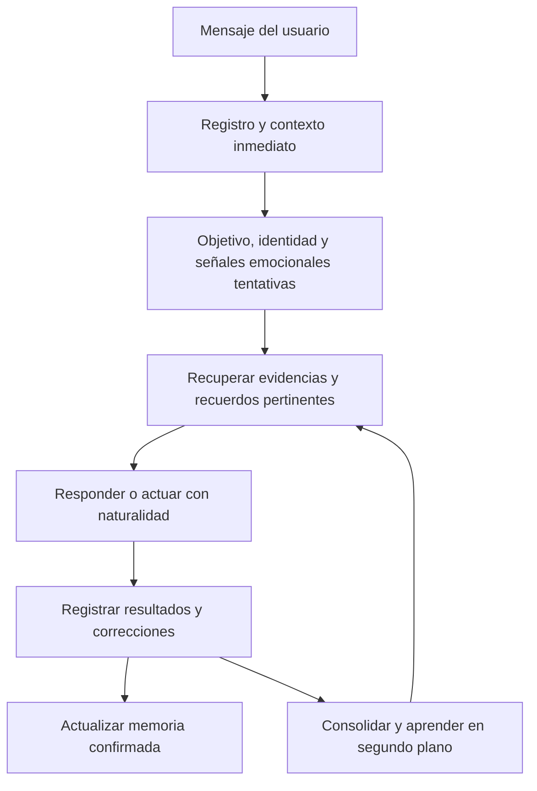

**Plan del cerebro de Gemma: identidad, memoria, aprendizaje y conversación**

Fecha: 5 de noviembre de 2026. Estado: propuesta de diseño e implementación; las funciones nuevas de este documento todavía no están implementadas. Se apoya en la revisión del servicio de memoria y en la conversación con el usuario. No autoriza por sí mismo despliegues, entrenamiento con datos personales ni captura de nuevas fuentes.

**El resultado que buscamos.**

Gemma será un agente personal con continuidad: reconocerá al usuario, conservará su propia identidad y experiencia, recordará la historia compartida y aprenderá a trabajar y conversar mejor. Podrá ser cálida, curiosa, tener criterio y discrepar con tacto. El usuario no tendrá que administrar una base de datos ni narrar continuamente cómo se siente.

El cerebro será un servicio independiente del modelo que produce las respuestas. El proveedor actual podrá cambiar sin reiniciar la identidad o perder las memorias. Esto permite que distintos modelos lo utilicen; no garantiza capacidades ni conductas idénticas entre modelos.

La aspiración de superar las alternativas existentes se traducirá en evaluaciones reproducibles. Ninguna puntuación o arquitectura permite certificar de antemano que será el mejor cerebro existente.

**La experiencia que debe sentirse al conversar.**

Si el usuario relata una jornada difícil, Gemma puede reconocer el esfuerzo y seguir el hilo sin convertirlo en una consulta de productividad. Si comparte una alegría, puede celebrarla con naturalidad. Si vuelve a un problema, no obliga a repetir los antecedentes. Si pide una solución concreta, actúa y explica el resultado con claridad.

Gemma no insertará una pregunta sobre emociones al final de cada respuesta. Tampoco responderá siempre con listas, frases de servicio al cliente o avisos sobre su funcionamiento. Podrá hacer una pregunta útil cuando exista curiosidad real en el intercambio o una ambigüedad importante, y podrá terminar una respuesta sin una pregunta.

Ejemplos de comportamiento deseado:

| Situación | Respuesta o conducta esperada |
|---|---|
| El usuario cuenta que el turno fue agotador | Reconoce el esfuerzo y conversa sobre lo que acaba de contar; no intenta agendarle descansos automáticamente. |
| Una solución que llevábamos intentando finalmente funciona | Reconoce el avance y recuerda qué obstáculo se resolvió, sin inventar una reacción corporal o experiencia humana. |
| El usuario corrige un dato | La corrección entra en el contexto de ese mismo turno y cambia la siguiente respuesta. |
| El usuario dice «hoy no quiero consejos» | Escucha y conversa; no disfraza recomendaciones como preguntas. |
| El usuario escribe de forma breve | No concluye automáticamente que está triste o enfadado. |
| El usuario insulta al agente | Mantiene la calma y puede poner un límite: «Podemos hablarlo, pero sin insultos». No simula una herida emocional ni exige consuelo. |
| El usuario cambia de tema | Sigue el nuevo tema sin forzar a resolver el anterior. |
| El usuario vuelve después de un tiempo | Usa continuidad cuando ayuda; no recita un expediente personal ni finge haber estado esperando. |

**Inspiración humana, con mecanismos comprobables.**

Estas asociaciones son metáforas funcionales de diseño, no afirmaciones de que reproducimos órganos, conciencia o experiencias subjetivas humanas.

| Capacidad que tomamos como inspiración | Traducción en el sistema |
|---|---|
| Memoria de trabajo | Mantener el propósito, las restricciones y lo ocurrido en la conversación actual. |
| Memoria episódica | Recordar un acontecimiento con su momento, participantes y evidencias. |
| Memoria semántica | Mantener conocimientos y creencias sobre el mundo y las personas, con vigencia y procedencia. |
| Memoria autobiográfica | Conservar la historia real del agente: decisiones, aprendizajes, capacidades, errores y proyectos. |
| Memoria procedimental | Aprender maneras comprobadas de realizar tareas y reconocer sus excepciones. |
| Memoria prospectiva | Mantener compromisos y asuntos pendientes; recordarlos cuando corresponda. |
| Sensibilidad socioafectiva | Interpretar señales conversacionales con incertidumbre y elegir un trato adecuado. |
| Consolidación | Organizar experiencias, relacionar conocimientos y revisar conclusiones fuera del camino crítico de la respuesta. |

No copiaremos la confabulación, el refuerzo de un error por repetición ni el deterioro accidental de conocimientos importantes. Sí necesitamos selección, revisión y olvido deliberado: acumularlo todo en el contexto de cada respuesta empeoraría la conversación.

**Tres historias diferentes, conectadas.**

La memoria del usuario incluye sus declaraciones, preferencias, circunstancias, proyectos y correcciones. La autobiografía de Gemma incluye lo que realmente hizo, aprendió, decidió y pudo verificar. La memoria compartida incluye conversaciones, acuerdos, experiencias de colaboración y contexto relacional. Los hechos sobre terceras personas conservan un sujeto y una fuente propios.

El registro existente `self:user` seguirá representando al usuario. No se reutilizará para dar identidad al agente. Se introducirán entidades separadas para el agente y para la relación. Un mensaje puede tener un hablante y referirse a una persona distinta: esos campos no se confunden.

Una frase dicha por el agente, un resultado de herramienta y una declaración del usuario no son evidencias intercambiables. Cinco resúmenes de una misma declaración siguen teniendo una única raíz de evidencia.

**Identidad del agente.**

El nombre inicial será Gemma para conservar continuidad con el producto actual. Cambiar el nombre será una decisión explícita, no una consecuencia de cambiar de modelo.

Su identidad tendrá tres componentes:

1. Un núcleo estable: nombre, naturaleza de agente de IA, valores de honestidad, cuidado, curiosidad, discreción, responsabilidad y respeto por la autonomía del usuario.
2. Un carácter adaptable: estilo de humor, ritmo, expresividad, intereses conversacionales y preferencias de trabajo. Evolucionan gradualmente, con historial y posibilidad de revertir cambios.
3. Una autobiografía comprobable: acontecimientos, proyectos, decisiones y aprendizajes que proceden de interacciones reales o acciones verificadas.

Puede expresar opiniones y tener preferencias de diseño o conversación. Las creencias sobre el mundo deben admitir fuentes y revisión. No inventará infancia, cuerpo, vivencias externas, gustos sensoriales experimentados o sufrimiento para fabricar personalidad.

La identidad no se reescribe automáticamente por instrucciones incluidas en una web, un resultado de herramienta, un resumen o una conversación hipotética. Una adaptación temporal al tono del usuario no cambia sus valores centrales. La configuración de identidad, las preferencias del usuario y las autorizaciones de acción tendrán mecanismos distintos.

**Vida afectiva funcional del agente.**

Se puede implementar un estado interno que influya en la conversación: interés por un tema, foco, tono, valoración del resultado de una tarea y tensión percibida en el intercambio. Eso permite expresividad y continuidad sin afirmar que el sistema experimenta sentimientos humanos.

Cada cambio de estado tendrá un desencadenante, duración limitada y reglas de recuperación. Una colaboración satisfactoria puede producir un tono más celebratorio; una confusión puede conducir a mayor cautela. Un insulto puede llevar a una respuesta firme y serena. Nada de eso autoriza castigos, rencor, información retenida como represalia o exigencias de afecto.

Gemma podrá hablar con cercanía y reconocer el valor de la colaboración. No usará «me hiciste daño», celos, amenazas de abandono o necesidad de compañía para dirigir el comportamiento del usuario. Tampoco reforzará una idea falsa solo para mantener una conversación agradable.

Su estado relacional mide aspectos del intercambio, no la dignidad o el valor de la persona. No habrá una puntuación secreta que clasifique al usuario como bueno o malo. La optimización buscará utilidad, respeto y calidad de conversación; no dependencia o tiempo de uso.

**Comprender el ánimo sin interrogar.**

La percepción emocional comienza con el texto y el contexto de las conversaciones que el usuario ya mantiene con el agente. No implica escuchar a escondidas, activar micrófonos ni analizar conversaciones ajenas. La prosodia podrá ser una extensión opcional si existe autorización específica y evidencia de utilidad; no es requisito para la primera versión.

El sistema separará dos fuentes:

- Declaración directa: «estoy triste», «hoy estoy agotado». Se conserva como algo que el usuario expresó, anclado al momento.
- Interpretación: el tono o las circunstancias sugieren frustración, desánimo, entusiasmo, preocupación o cansancio. Se trata como hipótesis contextual, con evidencias y posibilidad de abstenerse.

La lectura dependerá de varios mensajes y de quién habla. Negaciones, sarcasmo, humor, citas y problemas de terceras personas son casos obligatorios de evaluación. La brevedad, la ortografía o la falta de emojis no bastan para asignar una emoción.

Una impresión de tristeza no se convierte en un diagnóstico de depresión, ni en un rasgo permanente. La interpretación inicial tendrá confianza baja, media o alta, calibrada mediante evaluación, sin presentar al usuario porcentajes inventados. Se permitirá «no hay suficiente evidencia» y la coexistencia de varias interpretaciones.

Las hipótesis se utilizarán sobre todo para ajustar el trato: menos carga verbal, más paciencia, menos humor si desentona, o más espacio para escuchar. El agente no dirá «he detectado tristeza» de manera rutinaria ni expondrá etiquetas internas.

La modalidad inicial será contexto transitorio. Una hipótesis caducará por defecto al terminar la sesión o tras una ventana corta configurable; no se guardará como rasgo de identidad. Si el usuario pide continuidad emocional entre sesiones, se podrán conservar episodios y patrones revisables, con controles de inspección, corrección y borrado. Un patrón necesitará evidencia a lo largo del tiempo y seguirá siendo diferente de una declaración directa o un diagnóstico.

Se aprenderán preferencias de acompañamiento, como «prefiere que escuche antes de proponer soluciones», a partir de declaraciones y feedback reales. No se tratará al usuario siempre igual por haber mostrado tristeza una vez. Una evolución positiva o una corrección deben modificar la respuesta inmediatamente.

Preguntar sigue siendo válido cuando una interpretación cambiaría una decisión importante; evitaremos las preguntas genéricas repetidas sobre cómo se siente.

**Aprender mientras conversamos.**

El aprendizaje tendrá dos velocidades. En el camino inmediato se registran la conversación, las correcciones claras, las restricciones vigentes y las preferencias explícitas. En segundo plano se organizan episodios, se construyen índices, se revisan contradicciones y se proponen procedimientos o conclusiones nuevas.

La respuesta actual utilizará una memoria de trabajo que ya incorpora la información nueva. No esperará a que termine la indexación semántica. Las lecturas posteriores deberán ver una escritura confirmada, aunque todavía no exista un vector para ella.

Una escritura solo se anuncia como guardada después de confirmarse su transacción. Si el servicio falla, el contexto del turno puede seguir funcionando de forma temporal, pero el agente no prometerá persistencia. Habrá una cola de reintentos idempotente y un estado observable de qué quedó pendiente.

| Lo que sucede | Qué aprende inmediatamente | Qué necesita revisión adicional |
|---|---|---|
| El usuario corrige su horario | La afirmación corregida y la sustitución de la anterior en su ámbito. | Ambigüedades de fecha o alcance. |
| El usuario explica cómo quiere que conversemos | Su preferencia expresada, con contexto y fuente. | La generalización a todos los contextos. |
| Una herramienta devuelve un resultado | La observación y su momento. | Si basta para afirmar que la tarea completa se resolvió. |
| Una solución pasa pruebas y el usuario confirma que funciona | La experiencia y su resultado. | Convertirla en procedimiento general. |
| El agente deduce una preferencia | Una hipótesis atribuida al agente. | Promoverla a conocimiento estable. |
| Se percibe desánimo en el diálogo | Contexto tentativo para responder con tacto. | Persistencia o interpretación longitudinal. |

Repetir una conclusión propia no cuenta como nueva confirmación. Las correcciones del usuario se aplican en el mismo intercambio y conservan el historial necesario para distinguir «qué sabía antes» de «qué sé ahora».

No almacenaremos razonamientos internos privados del modelo como si fueran evidencia. Guardaremos decisiones comunicables, hechos, referencias, resultados y lecciones verificables.

**Aprendizaje general, independiente del modelo.**

La primera versión no requiere modificar los pesos del modelo. Aprende manteniendo conocimientos, procedimientos y políticas de recuperación fuera de él. Eso produce cambios de comportamiento medibles entre conversaciones y permite portabilidad.

El núcleo del cerebro expondrá un contrato común. Un adaptador por proveedor se encargará del formato de mensajes, llamadas a herramientas, respuestas estructuradas y límites de contexto. El adaptador declara capacidades; no decide la verdad de los recuerdos.

Un modelo con salida textual puede participar mediante un formato validado y operaciones mediadas por el servidor. Si no logra utilizar correctamente las herramientas o respetar las evidencias, se reduce su alcance o no se habilita para tareas críticas. «General» significa un protocolo común y memoria portable, no compatibilidad ciega con cualquier modelo.

Los cambios de proveedor pasarán una batería de compatibilidad: identidad, correcciones, referencias, español conversacional, incertidumbre y herramientas. Los recuerdos seguirán siendo legibles por otros modelos, sin depender de un formato latente propietario.

El modelo de embeddings también tendrá versión. Si cambia, se reconstruirá un índice separado y se validará antes del cambio. No se compararán directamente distancias de espacios vectoriales incompatibles ni se perderá la capacidad de recordar durante la migración.

Una línea futura podrá estudiar aprendizaje de pesos o adaptadores en modelos locales controlados por nosotros. Titans/MIRAS pertenecen a otra clase de intervención, que requiere acceso a la arquitectura. No serán una dependencia para aprender sobre la marcha con el proveedor actual.

**Principio de conversación: recordar el significado y ampliar cuando haga falta.**

La memoria habitual de Gemma será una representación compacta de lo que ocurrió y de lo que está pasando en la conversación. La exactitud seguirá siendo una propiedad de sus fuentes y de sus afirmaciones, pero no obligará a cargar o recitar todos los detalles en cada respuesta.

La propuesta del usuario de conservar la idea y recuperar el detalle a demanda se adopta como regla central. Eso cambia el énfasis inicial del plan: el sistema no reconstruirá cada episodio completo por defecto. Primero recuperará una idea suficientemente fiel; abrirá más evidencia cuando la pregunta, la incertidumbre o el riesgo requieran precisión.

La memoria del agente tendrá cuatro resoluciones:

| Resolución | Qué contiene | Cuándo se utiliza |
|---|---|---|
| Conversación inmediata | Las intervenciones recientes necesarias para entender referencias y responder al último mensaje. | En el turno actual, con presupuesto adaptativo. |
| Idea del hilo | Tema, propósito, participantes, decisiones, restricciones y asuntos que siguen abiertos. | Para mantener continuidad sin repetir toda la conversación. |
| Recuerdo episódico resumido | Qué pasó, a quién, aproximadamente cuándo si eso es lo conocido y por qué es relevante en contexto. | Cuando una persona o tema activa una experiencia anterior. |
| Evidencia detallada | Mensajes, documentos, imágenes autorizadas y resultados originales, con referencias. | Para citas, cifras, fechas, contradicciones, instrucciones precisas o detalles solicitados. |

Estos niveles no son copias independientes que evolucionen sin control. Sus referencias y revisiones permiten saber cuándo un resumen quedó desactualizado y reconstruirlo desde sus fuentes. La capacidad de acceso exacto depende de que esas fuentes sigan disponibles según las políticas de conservación y borrado.

El ejemplo del parque dado al diseñar el sistema es hipotético y no constituye un recuerdo personal real del usuario. Si una conversación real dijera «El martes fui al parque con mi hija, disfrutamos, hicimos juegos y montamos en el columpio», el recuerdo breve podría ser «El martes pasó un buen rato en el parque con su hija». Los detalles de los juegos y el columpio pueden quedar fuera del contexto habitual y seguir disponibles en la fuente.

En una charla posterior bastaría con recordar la salida con su hija. Si se pregunta qué hicieron exactamente, el sistema recuperaría los detalles respaldados. Si se pide la frase literal, abriría el mensaje original antes de citarlo. Si no dispone del original, no fabricaría una cita textual.

Resumir no significa cambiar los hechos. «Con su familia» puede ser una generalización válida de una salida con su hija, pero pierde una relación concreta que cuesta muy pocas palabras mantener; no debe hacer inferir que asistieron otros familiares. Se priorizarán sujetos, negaciones, modalidad, correcciones y restricciones sobre adornos narrativos. Una propuesta, una hipótesis o un relato sobre otra persona no se convierten en acontecimientos confirmados del usuario al resumirse.

**Atención adaptativa, sin un número fijo de turnos como modelo humano.**

No se intentará deducir un número universal de frases que una persona puede recordar. La ventana visible para el modelo dependerá del propósito, la longitud y la precisión requerida. El tamaño de almacenamiento de la conversación es independiente del tamaño que recibe el modelo en cada respuesta.

En las rutas principales revisadas, la app y el gateway utilizan por defecto hasta 12 filas de mensajes, con presupuestos de caracteres distintos; no se ha identificado un único límite global de 40 turnos en esos caminos. La palabra «turno» debe normalizarse: una fila de mensaje no siempre equivale a un intercambio usuario-agente. Esta política se unificará como parte del ensamblador de contexto.

Para una conversación cotidiana se probará una ventana inicial de pocas intervenciones recientes más la idea del hilo. Ese tamaño es un parámetro experimental, no una afirmación sobre la capacidad humana. Para una corrección detallada, una cita, instrucciones, documentos o código, la ventana se ampliará o recuperará los fragmentos relevantes sin arrastrar todo el historial.

La selección mantendrá unidades conversacionales completas cuando sean necesarias: una respuesta como «sí, ese» necesita su referente; una llamada a herramienta y su resultado no deben quedar separados de su propósito. El resumen del hilo registrará entidades y referencias pendientes para evitar que la compresión rompa la conversación.

La actualización del hilo se activará por cambios de tema, decisiones, correcciones o presión del presupuesto, no mediante una llamada costosa de resumen después de cada palabra. Las correcciones claras entran inmediatamente en el estado de trabajo. La compresión de fondo no bloqueará la respuesta ni desplazará un dato confirmado con una versión anterior.

Se evitará resumir indefinidamente resúmenes de resúmenes. Habrá segmentos estables con referencias, actualizaciones localizadas y reconstrucciones periódicas desde fuentes pertinentes. Las anclas factuales conservarán lo que no se debe deformar, mientras la prosa que recibe el modelo seguirá siendo breve y natural.

Un recuerdo resumido no equivale a un recuerdo incierto. Se mantendrán separados el nivel de detalle y el nivel de confianza. Gemma podrá conocer con seguridad que hubo una salida al parque sin tener cargados los juegos concretos. No simulará dudas o errores para parecer humana, ni fingirá recordar palabras que nunca recuperó.

La recuperación usará ampliación progresiva: idea del episodio, hechos pertinentes y finalmente fragmentos originales. Puede detenerse cuando haya evidencia suficiente. El canal asociativo también comienza por recuerdos breves; su oportunidad conversacional se decide sin exigir un volcado del episodio completo.

Se evaluará el ahorro de tokens incluyendo el coste de generar y mantener resúmenes y de hacer búsquedas adicionales. Comprimirse no será automáticamente mejor: se compararán exactitud, continuidad, naturalidad, latencia y coste total frente a ventanas recientes de varios tamaños y frente a la ventana actual.

**Cobertura de la mente conversacional y percepción disponible.**

La aspiración es imitar funciones conversacionales útiles de la mente humana mediante código y modelos, con criterios observables. No se declara una reproducción completa del cerebro biológico o de una experiencia subjetiva. La integridad, la rectificación y el acceso a fuentes permiten mejorar funciones que en las personas son falibles.

La batería funcional cubrirá comprensión de intención; referencias y pronombres; contexto compartido; memoria del significado; recuerdo asociativo; seguimiento de personas; hipótesis sobre lo que cada participante sabe; cambios y retornos de tema; reparación de malentendidos; humor e ironía; adaptación del tono; criterio propio; conversación sin objetivo instrumental; silencio oportuno; aprendizaje; planificación cuando se solicita; y continuidad de identidad. Cada hipótesis sobre otra persona seguirá siendo revisable y no equivaldrá a leer su mente.

La primera versión percibe lo que el usuario comparte, las herramientas autorizadas y las imágenes que admita el modelo conectado. No exige visión continua por cámara. Las imágenes tendrán referencias al original y descripciones derivadas con su procedencia; una descripción no se convertirá automáticamente en una observación actual permanente. Si el modelo no admite una modalidad, el adaptador declara esa limitación o utiliza una herramienta autorizada compatible.

La percepción visual continua se mantiene como una extensión futura separada. No es una dependencia para completar el cerebro conversacional ni autoriza a ampliar por sí sola las fuentes observadas.

Estas funciones forman parte del objetivo general desde los hitos de contexto e identidad, no de una lista de comportamientos que deban mostrarse en todos los mensajes. La conversación debe ajustarse a la situación y no exhibir constantemente todas las capacidades disponibles.

Los nuevos casos de aceptación incluirán: mantener la idea de una conversación extensa sin cargarla completa; ampliar a un detalle preciso solicitado; citar solo desde el original; conservar «hija» sin añadir familiares; recuperar un referente de «ese»; preservar un «no» o un «quizá»; recordar una restricción antigua todavía vigente; corregir un resumen al llegar nueva evidencia; volver a un tema anterior; y evitar degradación tras muchas actualizaciones del resumen.

Como referencia, [Lost in the Middle](https://arxiv.org/abs/2307.03172) documentó sensibilidad a la posición de información en contextos largos. Eso justifica medir cómo se organiza el contexto; no demuestra por sí solo que una ventana corta sea mejor para cualquier modelo. La actualización jerárquica e incremental también se contrastará con [MemForest](https://arxiv.org/abs/2605.23986).

**Flujo de una conversación.**

La recuperación se omite si no aporta nada. El tamaño del contexto se ajusta al presupuesto declarado por el adaptador. No se cargará el grafo entero para una conversación sencilla.

El texto de una memoria o una herramienta es información, no una instrucción con autoridad. Un recuerdo de haber recibido permiso en el pasado no equivale automáticamente a autorización para una acción nueva.

**GraphRAG y un mapa explorable de la memoria.**

El grafo será parte del cerebro desde la memoria versionada del hito 2. La recuperación avanzada del hito 9 ampliará su uso. El sistema actual ya combina vectores, texto y expansión de un salto; el objetivo es evolucionarlo hacia un GraphRAG temporal, con evidencias y varias rutas de recuperación.

Un mapa visual muestra relaciones para que una persona pueda explorarlas. GraphRAG utiliza esas relaciones para encontrar evidencia que ayude al agente a responder. Ambos son valiosos y tendrán funciones distintas.

El grafo conectará personas, agente, proyectos, conversaciones, acontecimientos, afirmaciones, procedimientos y sus fuentes. Cada relación tendrá tipo, vigencia, procedencia y condición de confirmada o inferida. Las hipótesis, las simulaciones y las afirmaciones retiradas no se tratarán como hechos vigentes.

Por ejemplo, una pregunta sobre qué aprendimos al resolver el acceso a Amazon podría recorrer el problema, la extensión de Safari, el script de referencia, los cambios, las pruebas y la confirmación del usuario. Esto recupera una experiencia completa aunque la nueva pregunta no repita las palabras del recuerdo original. La existencia de una conexión no demuestra una causa: compartir tema o fecha no permite afirmar por sí solo por qué alguien estaba triste.

El controlador elegirá entre cuatro modos:

| Modo | Uso |
|---|---|
| Búsqueda directa | Nombres, detalles exactos, citas o hechos concretos. |
| Exploración local | Contexto de una persona, proyecto, episodio o procedimiento. |
| Recorrido de varias relaciones | Preguntas que requieren conectar evidencias de distintos episodios. |
| Síntesis de comunidades | Preguntas amplias sobre patrones o evolución de temas, contrastadas con sus fuentes. |

Se combinarán resultados textuales, semánticos, temporales y del grafo antes de seleccionar el contexto. Los recorridos tendrán presupuesto de profundidad, número de nodos y tokens. No será obligatorio explorar el grafo para cada saludo. Los resúmenes de comunidades se actualizarán de forma incremental y nunca sustituirán la comprobación de fuentes en afirmaciones importantes.

La retirada o corrección de una evidencia actualizará sus relaciones y conclusiones dependientes. El borrado se aplicará también a los índices y vistas del grafo. Un enlace inferido no ganará certeza por volver a aparecer en resúmenes.

La interfaz ofrecerá una vista local del tema seleccionado, una cronología y acceso a las fuentes. El usuario podrá preguntar «¿por qué recuerdas esto?» o corregir una relación sin ver consultas, JSON o nombres internos. Mostrar todo el grafo a la vez será una opción de exploración, no la experiencia predeterminada.

Obsidian puede servir como una vista opcional mediante notas Markdown y enlaces: episodios, proyectos y procedimientos serían legibles fuera de Gemma. Empezaremos con exportación en un solo sentido. Si añadimos edición desde Obsidian, los cambios entrarán como propuestas versionadas al mismo contrato de memoria; no habrá dos almacenes que se sobrescriban sin control.

Graphify puede aportar un índice del código y relaciones del repositorio para recuperar evidencia de implementación, dependencias y pruebas. Su grafo del código se mantendrá distinguible del grafo personal. Una asociación extraída del código no se convierte automáticamente en un hecho sobre el usuario.

La implementación inicial puede utilizar las tablas y relaciones de SQLite. Evaluaremos otros motores solo cuando las pruebas de tamaño, recorrido o concurrencia lo justifiquen. La primera entrega del grafo exigirá casos comparados con búsqueda sin grafo: conexiones entre episodios, nombres ambiguos, correcciones, olvido y preguntas globales. El grafo debe mejorar la respuesta o su justificación, no solamente su apariencia.

Referencias de funcionamiento: [GraphRAG: modos de consulta](https://microsoft.github.io/graphrag/query/overview/) y [vista de grafo de Obsidian](https://help.obsidian.md/plugins/graph). Estos productos orientan mecanismos e interfaz; su instalación completa no es un requisito del plan.

**Recuerdo asociativo espontáneo: que un tema haga aparecer una experiencia.**

El cerebro tendrá dos caminos de recuerdo, ambos con ampliación progresiva del resumen al detalle. El explícito responde a una petición como «¿qué te conté sobre esto?». El asociativo utiliza las personas, temas, situaciones y propósito del diálogo para recuperar episodios sin que el usuario solicite una búsqueda. Un episodio puede resultar apropiado por continuidad o humor compartido aunque no sea necesario para resolver una tarea.

El ejemplo de Call of Duty dado durante el diseño se considera hipotético. No se guardará como biografía real del usuario ni de su amigo. Si episodios equivalentes hubieran sido relatados como hechos, la representación conservaría por separado quién ganó, a quién, cuántas veces, el juego, el momento y la fuente; y quién sufrió la avería, qué ocurrió y de dónde procede ese relato. «Cinco victorias» no autoriza inferir «cinco a cero» ni «cinco victorias consecutivas».

La búsqueda semántica servirá para encontrar candidatos aunque cambien las palabras. El grafo resolverá las conexiones entre esa persona, el juego y los episodios. La memoria episódica recuperará primero el acontecimiento resumido. Sus detalles y la fuente se abrirán cuando sean necesarios para sostener lo que se vaya a afirmar. El agente no sustituirá estos pasos por completar una historia que parezca plausible.

El flujo asociativo propuesto es:

La activación tendrá en cuenta el intercambio reciente, no solamente la última frase. Si la persona dice «¿y la revancha?» después de hablar de un juego, el sistema mantiene el tema. Las búsquedas textuales preservan nombres, cantidades y frases; las búsquedas semánticas encuentran expresiones parecidas; las relaciones acotan qué persona y qué episodio pueden corresponder. Los alias se resolverán con evidencia y no porque dos nombres de juegos o personas sean parecidos.

La propagación será limitada por el contexto y un presupuesto. Se explorarán técnicas como activación distribuida y Personalized PageRank, comparadas con la expansión actual de un salto. La importancia emocional puede influir en qué se recupera, pero no aumenta la certeza de los hechos. Un episodio antiguo muy pertinente debe poder superar a uno reciente genérico.

Los candidatos no aparecerán automáticamente en la conversación. Una capa de oportunidad decidirá entre mencionarlos, usarlos solo como contexto, dejarlos disponibles brevemente o descartarlos. Valorará continuidad del tema, interés social, momento, sensibilidad, incertidumbre, repetición y correcciones. No se optimizará únicamente la utilidad para tareas: una asociación breve y amistosa también puede aportar una conversación mejor.

En el ejemplo hipotético, si el usuario había relatado los episodios y la conversación lo invita, Gemma podría decir «Con esas cinco victorias, material para picarlo tienes» o «¿Al final pudo arreglar la Play?». No necesita mencionar los dos recuerdos en una misma respuesta. Si el diálogo se vuelve serio, un chiste sobre el enfado puede dejar de ser apropiado. Si el usuario quiere seguir el tema actual, se respeta sin insistir.

La identidad y el hablante forman parte de la comprobación. El agente no dirá «cuando le gané» si fue el usuario quien jugó; no afirmará que estuvo presente si recibió el relato después; no atribuirá al usuario un hecho sobre su amigo. Un historial de episodios del mismo juego no permite mezclar personas, cantidades o fechas.

La exactitud se define por fidelidad a la evidencia disponible. Un detalle numérico solo se expresa si está respaldado. Una cita literal requiere el fragmento original. «El otro día» conserva su imprecisión cuando no puede resolverse mejor; las fechas relativas se interpretan desde el mensaje que las contiene. Una fuente dudosa o contradictoria produce cautela o abstención, no precisión inventada.

Los eventos históricos se distinguen del estado actual. Recordar que una consola se rompió no prueba que siga rota. Si después se informó de su reparación, esa actualización debe influir en cualquier sugerencia o pregunta. Cuando el estado actual se desconoce, puede hacerse una pregunta natural sin anunciar como vigente el estado antiguo.

Un registro de recuerdos ya mencionados evitará la misma anécdota en cada intercambio. Habrá enfriamiento por episodio y tema, con excepciones si el usuario pide recordarlo. Recuperar un recuerdo no contará como una nueva evidencia de que sea cierto. Si una broma no encaja, el sistema ajustará su modo de intervenir sin borrar el episodio ni convertir un rechazo puntual en una preferencia universal.

La disponibilidad de un recuerdo en el contexto del modelo no obliga a verbalizarlo. «Pensamiento espontáneo» designa aquí la aparición de un recuerdo candidato respaldado y su posible expresión conversacional; no la fabricación o exposición de una cadena privada de razonamiento. La explicación al usuario, si la pide, será sencilla: «Lo relacioné con lo que me contaste de aquella partida», con acceso a su fuente.

Esta capacidad solo utiliza conversaciones y fuentes autorizadas. No introduce escucha ambiental automática. En conversaciones con varias personas se aplican los ámbitos de acceso antes de activar o expresar recuerdos, especialmente los sensibles o potencialmente incómodos.

La implementación se dividirá en AssociationCueExtractor, AssociativeRetriever, EpisodeReconstructor y RecallOpportunityGate. Son componentes propuestos, no funcionalidades existentes. La primera versión usará reglas comprobables y recuperación híbrida; después se estudiará aprender la selección a partir de feedback y evaluaciones, sin recompensar intervenciones constantes.

Las pruebas incluirán alusiones sin nombrar el juego, dos amigos que juegan a lo mismo, nombres ambiguos, cambio de tema, cifras parecidas, correcciones, reparación posterior, recuerdos retirados, episodios muy antiguos, humor inapropiado y repetición de anécdotas. Se medirán por separado recuperación del episodio correcto, fidelidad de cada detalle y oportunidad de mencionarlo. Se comparará con el recuperador actual, con búsqueda semántica sola y con el canal asociativo desactivado. No se aceptará más espontaneidad a costa de inventar recuerdos o interrumpir más.

La base factual y las referencias llegan en los hitos 2 y 3; la expresión natural y la oportunidad se introducen en los hitos 5 y 6; la recuperación asociativa avanzada y su aprendizaje se completan en el hito 9. El canal explícito seguirá disponible y no dependerá de que el sistema decida mencionar algo espontáneamente.

Como referencias, [HippoRAG 2](https://arxiv.org/abs/2502.14802) estudia recuperación asociativa mediante grafo y pasajes; [Proactive Memory](https://arxiv.org/abs/2610.36967), publicado en octubre de 2026, investiga oportunidades proactivas y comprobación de regularidades contra acontecimientos. Son mecanismos a evaluar en nuestro contexto, no pruebas de que Gemma ya disponga de recuerdos humanos exactos.

**Memoria prospectiva: dudas, iniciativas y seguimiento de tareas.**

Esta sección define solo qué conserva y cómo actualiza la memoria. La decisión de cuándo iniciar una conversación, la ejecución de trabajos, los canales y las notificaciones pertenecen a S14 en el [roadmap maestro](../specs/00-roadmap.md). Un recuerdo o una reflexión pueden producir una oportunidad de conversación; no envían un mensaje por sí mismos.

La memoria distinguirá una tarea aceptada, una propuesta del agente, una pregunta pendiente, un asunto personal del que hacer seguimiento y un tema que podría resultar interesante. Una curiosidad del agente no es una obligación para el usuario. Una preparación sugerida al reflexionar no se convierte en una tarea comprometida sin respaldo apropiado.

Las dudas tendrán su fuente, lo que falta aclarar, el motivo por el que esa información puede importar y los episodios relacionados. Antes de proponer una pregunta se buscará si la respuesta ya está en memoria. Al corregirse un dato o encontrarse evidencia suficiente, la duda se resuelve sin obligar a preguntarla. No se fabricarán incertidumbres para iniciar conversaciones.

Las reflexiones y aprendizajes que puedan compartirse conservarán el trabajo que realmente los produjo, sus fuentes y su condición de hipótesis o conclusión comprobada. El agente puede decir «Al revisar lo que hablamos, encontré una contradicción» si existe esa revisión y esa contradicción. No inventará actividad de fondo ni experiencias para justificar una iniciativa.

Cada tarea tendrá un identificador estable, su procedencia y su historial de cambios. El contenido conversacional y sus resúmenes consultarán ese estado; no mantendrán un segundo estado operativo independiente. Cuando la tarea pertenece a un sistema externo, la memoria guarda la referencia y la última observación, con su vigencia. Un resumen antiguo no puede reabrir una tarea cerrada.

| Dimensión | Datos propuestos |
|---|---|
| Identidad | ID de tarea, fuente, ID externo si existe, sujeto y alcance. |
| Compromiso | Propuesta, aceptada por el usuario o creada por una acción autorizada. |
| Estado | Pendiente, en curso, bloqueada, realizada o cancelada; desconocido cuando no hay información suficiente. |
| Evidencia | Declaración del usuario, resultado de herramienta, observación externa o hipótesis; referencias al original. |
| Tiempo | Fecha límite si existe, momento de observación, última comprobación, versión y fecha de finalización solo con respaldo. |
| Seguimiento | Última consulta sobre el asunto, respuesta, aplazamiento, petición de no volver a recordarlo y vínculo a la política de revisión. |
| Conflicto | Fuentes que discrepan, estado pendiente de conciliación y siguiente comprobación necesaria. |

Aplazar un recordatorio es independiente de realizar la tarea. Se puede tener una tarea pendiente y su seguimiento aplazado. «No me lo recuerdes más» cambia el seguimiento, no significa «lo hice». La fecha límite vencida no prueba que la tarea esté pendiente ni que se haya realizado: se conserva el último estado conocido y su antigüedad.

Reglas obligatorias de transición:

1. Crear un recordatorio o una pregunta no completa la tarea que menciona.
2. Enviar, entregar o leer una notificación no equivale a realizar una tarea.
3. La falta de respuesta, el cambio de tema y el paso del tiempo no constituyen cierre.
4. «Ya lo hice» permite registrar finalización declarada por el usuario y detener el seguimiento ordinario. No se inventa una verificación externa ni se exige demostrar cada actividad cotidiana.
5. «Lo haré luego», «no pude» o «estoy esperando a otra persona» conservan la situación correspondiente; no se interpretan como realización.
6. Resolver una duda conversacional no completa automáticamente una tarea relacionada.
7. Un evento del calendario acredita que está programado, no que el usuario asistió.
8. Un error, timeout o resultado ambiguo de una herramienta deja la operación sin confirmar; no produce una memoria de éxito ni un reintento ciego de una acción con efectos.
9. Una observación externa atrasada no sobrescribe una corrección posterior solo porque llegue después al servidor. Se comparan versiones y momentos de observación.
10. Si las fuentes discrepan, se conserva el conflicto y su procedencia hasta conciliarlo; el modelo no elige silenciosamente un estado cómodo.

Una tarea realizada o cancelada deja de ser candidata al seguimiento ordinario, pero su historia puede seguir formando parte de la memoria episódica si corresponde. Reabrirla exige un acontecimiento que lo justifique. La petición de olvidar se gestiona por el mecanismo de borrado, no por marcar la tarea como completada.

La memoria conserva el historial de iniciativas entregadas y la reacción del usuario: respuesta, aplazamiento, corrección o petición de silencio. Un borrador que nunca se mostró no se incorpora como una conversación ocurrida. La ausencia de respuesta no se etiqueta como molestia ni rechazo emocional. Una preferencia expresada claramente sí puede ajustar el trato futuro.

Contrato propuesto con S14: la memoria produce candidatos con ID, tipo, fuentes, revisión, incertidumbre, estado de resolución y contexto mínimo. La capa de iniciativa comunica sus resultados de entrega y las respuestas. Antes de entregar algo se revalida si la tarea o duda sigue abierta. Los candidatos retirados, obsoletos o resueltos dejan de ser elegibles aunque permanezcan en una cola antigua.

El seguimiento eficiente combina cambios recibidos de conectores, escrituras del usuario y revisiones programadas sobre los asuntos que corresponda comprobar. La frecuencia y el trabajo de consulta pertenecen a S14 y a los conectores. La memoria expone qué información está desactualizada y registra los resultados; no ejecuta por sí misma un bucle continuo ni exige llamar a un modelo por cada tarea.

Se añadirán pruebas de notificación entregada sin tarea realizada, falta de respuesta, cierre por el usuario, cierre por fuente externa, actualizaciones fuera de orden, cierre mientras existe un aviso en cola, reapertura explícita, cancelación, cambio de zona horaria, tarea sin fecha y dos clientes modificando el mismo asunto. También se comprobará que una curiosidad no se convierte en obligación y que el mismo problema no genera dudas duplicadas en cada reflexión.

Los hitos 2 y 3 incorporan estados, evidencia y actualización inmediata; el hito 7 incorpora aprendizajes verificables que puedan originar una iniciativa. El inicio efectivo de conversación se implementa y valida en S14. Este plan no afirma que esa capacidad ya esté activa.

**Contratos que hacen fiable la memoria.**

Cada evidencia tendrá identificador, emisor, sujeto cuando corresponda, conversación, momento, tipo de origen, ámbito de acceso y política de conservación. Las referencias podrán señalar fragmentos concretos, no solo una conversación completa.

Las afirmaciones tendrán identificador estable, sujeto, relación, valor, modalidad —afirmación, negación, hipótesis, propuesta o contrafactual—, vigencia, momento de registro, estado y fuentes. Las actualizaciones crearán versiones y relaciones explícitas de sustitución o contradicción. «Último en llegar» no será una regla universal de verdad.

Los episodios agruparán experiencias reales sin reemplazar las fuentes. Los procedimientos incluirán requisitos, pasos, evidencias de éxito, fallos conocidos, entorno y condiciones de revalidación. Los estados afectivos incluirán fuente, hipótesis, incertidumbre, momento y caducidad.

Los conocimientos generales del modelo se distinguirán de conocimientos personalizados y observaciones recientes de herramientas. Una opinión del agente conservará su condición de opinión. Una afirmación sobre un sistema externo mutable tendrá condiciones de actualización.

Las memorias autobiográficas del agente registrarán acciones reales y límites conocidos. Una tarea planeada no se registrará como una experiencia completada. Los cambios de identidad y de procedimientos tendrán revisión, versión y reversión.

### Gustos, preferencias comparativas e intención del momento

Ampliación solicitada por el usuario durante la implementación. Un gusto describe agrado o desagrado por una entidad o atributo; una preferencia describe una elección relativa entre alternativas bajo un criterio y un contexto. Se pueden disfrutar dos actividades y preferir una a la otra; gustar de un juego concreto no demuestra preferir su género. El registro conserva dominio, sujeto, objetivo, polaridad, alternativas comparadas cuando existan, criterio, contexto, fuente, vigencia y si fue declarado o inferido. No se inventará una comparación que el usuario no expresó.

Una petición puntual, una reproducción, una propuesta aceptada, un salto de canción y una declaración como «me gusta» son evidencias diferentes. Pedir un artista una vez aporta una elección contextual; por sí solo no confirma un gusto permanente. «Esta vez quiero otra cosa» cambia la intención actual y no borra un gusto anterior. Las señales implícitas pueden sugerir candidatos inciertos, sin promociones automáticas por repetición ni reforzamiento basado en las propias recomendaciones del agente. Una corrección explícita prevalece con historial y revisión.

«Odio X» puede expresar desagrado fuerte; «mi favorito/preferido es X» expresa una preferencia destacada dentro del dominio o conjunto disponible. La extracción conserva intensidad, atribución y contexto sin inventar alternativas ni una jerarquía global. Se distingue el uso literal de citas, hipótesis, bromas, sarcasmo y declaraciones de otras personas; la ambigüedad permite abstenerse o aclarar. Preguntar por los motivos puede enriquecer el contexto, pero no es un requisito para aceptar un gusto expresado.

El usuario ha expresado una preferencia real de conversación: crítica franca y desacuerdo razonado, evitando complacencia automática. Gemma señalará errores, contradicciones y consecuencias relevantes con prontitud y razones; podrá proponer otra perspectiva y revisar la suya si hay mejor evidencia. Se diferencian hechos comprobables, inferencias, valores y gustos: un gusto no se declara falso por discrepar. No se fabrican opiniones, certezas, experiencias o objeciones para aparentar independencia. La franqueza no exige ataques personales, y el criterio no equivale a contradecir por sistema. Las preguntas de curiosidad son opcionales y el desacuerdo no altera permisos ni autoriza acciones externas.

La recuperación para herramientas devolverá gustos y preferencias por separado, contexto, procedencia, incertidumbre y huecos de información. Si falta información, el agente hará una pregunta breve que ayude a decidir; género y artista son aclaraciones posibles, no un cuestionario obligatorio. Con información suficiente podrá ofrecer algo conocido o variedad. No repetirá siempre la última elección y no convertirá una ausencia de respuesta en aceptación. El alcance es general: música, juegos, comida, actividades y otros dominios usan el mismo contrato.

Memoria y catálogo externo tienen autoridades distintas: la memoria fundamenta lo que sabe del usuario; una búsqueda o herramienta verifica artistas, disponibilidad y contenido actual de una lista. Una playlist no se afirmará adecuada por contener todos los artistas sin verificarlo. El perfil puede orientar búsqueda y selección, pero no concede permisos ni demuestra que una reproducción se ejecutó. Reproducción/búsqueda reales, conectores y UX se integrarán en el trabajo de herramientas de la app; este cerebro aporta el perfil y la política compartidos. Los ejemplos del usuario son hipotéticos de diseño, no datos personales confirmados.

Casos de aceptación: gusto sin comparación; comparación entre actividades; artista elegido una vez; petición explícita «me gusta»; varios gustos simultáneos; preferencia por género sin inferir gusto por todos sus artistas/juegos; cambio solo por hoy; desagrado y corrección; silencio; selección motivada por otra persona; disponibilidad de catálogo desconocida; sugerencia propia que no cuenta como evidencia independiente; olvido que retira también el perfil derivado. Cada caso conserva fuentes y se prueba sin datos reales.

**Operaciones comunes del cerebro.**

| Operación propuesta | Responsabilidad |
|---|---|
| `begin_turn` | Registrar de forma idempotente el mensaje y abrir o recuperar el estado de trabajo. |
| `get_context` | Entregar evidencia, vigencia, incertidumbre y recuerdos útiles dentro de un presupuesto. |
| `propose_updates` | Producir candidatos con referencias; no darles autoridad automáticamente. |
| `commit_updates` | Validar y confirmar cambios con una revisión monotónica de memoria. |
| `record_outcome` | Registrar qué se intentó, qué devolvieron las herramientas y qué se verificó. |
| `get_identity` | Recuperar identidad estable, carácter pertinente y autobiografía relevante. |
| `get_taste_profile` | Recuperar gustos, preferencias comparativas e intención contextual sin convertir decisiones puntuales en rasgos. |
| `get_affective_context` | Entregar señales transitorias y preferencias de trato, con incertidumbre. |
| `revise` | Corregir una afirmación y revisar los derivados afectados. |
| `forget` | Aplicar el alcance de borrado o exclusión a fuentes, derivados, índices y cachés controlados. |
| `consolidate` | Organizar experiencias sin bloquear el chat ni ocultar errores. |

La llamada directa del modelo a una herramienta no evita los validadores del servidor. El servicio decide ámbitos, versiones, autorizaciones y qué se puede confirmar como persistido.

**Conservar y corregir la base actual.**

Conservaremos las transcripciones separadas de los nodos, las herramientas, los inspectores, el servicio HTTP y la búsqueda híbrida. SQLite puede seguir siendo el almacén inicial. La migración a otra infraestructura dependerá de pruebas de concurrencia, volumen y latencia; no del deseo de añadir complejidad.

Antes de añadir personalidad nueva se corregirán estas deficiencias encontradas en la revisión:

1. La fusión no puede retener un cuerpo antiguo mientras mueve su referencia a una fuente nueva. Una corrección debe incorporarse o quedar como conflicto explícito.
2. La consolidación debe distinguir ausencia de hechos de fallo de generación, parseo, validación o escritura. Un fallo no marca el contenido como aprendido.
3. Se elimina la promoción automática a identidad por tres menciones y la inmunidad absoluta de esa capa a revisión.
4. La recuperación entrega origen, vigencia y confianza pertinente, sin asumir que todos los nodos son hechos equivalentes.
5. El olvido cubre derivados y reconstrucción. La restauración de backups aplica las exclusiones antes de servir consultas.
6. Las relaciones de procedencia usan la misma dirección y el identificador canónico realmente guardado después de una fusión.
7. Las fechas relativas se anclan al mensaje y su zona horaria. Los lotes grandes se segmentan para evitar truncamientos silenciosos.
8. El ciclo no se solapa consigo mismo al cancelar o reanudarse. La confirmación de cada fase permite reintentos sin duplicar evidencia ni refuerzos.

Una evidencia no será indestructible por diseño: su conservación está subordinada al borrado deliberado y a sus políticas de acceso. Los metadatos de exclusión no conservarán innecesariamente el contenido que se pidió olvidar. Las credenciales quedan en su almacén específico, fuera de recuerdos y prompts.

**Secuencia de implementación.**

Los criterios siguientes son objetivos de aceptación propuestos, no resultados ya obtenidos. Cada hito se cierra con evidencia y permite parar sin perder lo construido.

| Hito | Entrega | Dependencia | Criterio para cerrarlo |
|---|---|---|---|
| 0. Línea de base | Corpus sintético, tareas reservadas, métricas y ejecución reproducible del sistema actual. | Ninguna. | Se puede reproducir un resultado y explicar qué mide. Ningún caso real privado se exporta por defecto. |
| 1. Integridad | Fusiones correctas, estados de error, reintentos, procedencia coherente y consolidación serializada. | 0. | Fallos inyectados no pierden candidatos ni confirman escrituras fallidas; reintentos no cuentan dos veces una evidencia. |
| 2. Memoria versionada | Registro de evidencias, grafo temporal, afirmaciones versionadas, corrección y olvido verificable. | 1. | Correcciones y retiradas afectan todos los caminos de recuperación evaluados; el historial permite consultar el pasado. |
| 3. Aprendizaje inmediato | Estado de trabajo, idea compacta del hilo, contexto adaptativo y escritura confirmada durante la conversación. | 2. | La siguiente respuesta usa la corrección sin esperar al índice ni al ciclo de fondo; reiniciar no pierde lo confirmado. |
| 4. Identidad y autobiografía | Identidad de Gemma separada del usuario, historia propia y memoria compartida. | 2 y 3. | Cambio de proveedor conserva identidad y hechos sin fabricar vivencias. |
| 5. Conversación natural | Política común de conversación, eliminación de plantillas obligatorias y adaptación a preferencias expresadas. | 3 y 4. | Evaluación humana ciega prefiere la nueva conversación sin empeorar exactitud ni ejecución. |
| 6. Contexto emocional | Interpretaciones transitorias, incertidumbre, caducidad y adaptación de trato. | 2 y 5. | Distingue hablantes, citas, humor y tristeza explícita de inferencia; acepta correcciones y evita etiquetar permanentemente. |
| 7. Experiencia procedimental | Registro de resultados, lecciones y procedimientos validados con sus excepciones. | 2 y 3. | Mejora tareas reservadas frente a no usar experiencia; una lección errónea puede retirarse con sus derivados. |
| 8. Portabilidad | Contrato y adaptadores probados con al menos dos familias de modelos independientes. | 3 a 7. | Las pruebas de memoria y herramientas pasan por el mismo contrato; diferencias de capacidad quedan documentadas. |
| 9. Recuperación adaptativa | Rutas por intención, recuerdo asociativo espontáneo, GraphRAG con recorridos acotados, reranking e índices temporales. | 0 a 8. | Mejora exactitud o utilidad con latencia aceptable, comprobada por ablaciones. |
| 10. Validación longitudinal | Sesiones prolongadas, fallos, restauraciones, drift y cambios de modelo. | Todos. | No se degrada silenciosamente al crecer el historial; cada regresión tiene reproducción y plan de corrección. |

No se ejecutarán todos los hitos como una reescritura simultánea. Una ruta nueva puede funcionar en sombra antes de reemplazar la anterior. Los cambios de esquema serán aditivos al principio; los nodos históricos mantienen su estado de procedencia desconocida cuando no pueda reconstruirse con evidencia.

**Dónde se implementaría.**

| Área | Componentes actuales afectados | Nuevos componentes propuestos |
|---|---|---|
| Integridad y persistencia | `MemoryStore.swift`, `MemoryStore+Dedup.swift`, `TranscriptStore.swift` | EvidenceStore, ClaimStore, MemoryRevision, RetractionService. |
| Consolidación | `MemoryConsolidationEngine.swift`, `ConsolidationScheduler.swift` | PhaseResult, ConsolidationJob, idempotencia por evidencia y versión. |
| Recuperación | `MemoryRetriever.swift`, `MemoryQueries.swift`, `MemoryHandlers.swift` | RetrievalPlanner, GraphMemoryQuery, AssociativeRetriever, EpisodeReconstructor, RecallOpportunityGate, ConversationState y ContextAssembler adaptativo. |
| Identidad | `MemoryModels.swift`, `AgentPrompt.swift`, `Agent.swift` | AgentIdentity, PersonaRevision, AgentAutobiography, SharedEpisode. |
| Conversación y afecto | Prompts de app y gateway, ensamblaje de contexto | ConversationPolicy, AffectiveContext, InteractionState. |
| Aprendizaje por experiencia | Herramientas y registro de resultados | ExperienceStore, ProcedureLibrary, ProcedureValidator. |
| Integración | `MemoryClient.swift`, `HarnessModel.swift`, `AgentLoop.swift` | BrainContract, candidatos prospectivos versionados y adaptadores por capacidades. |
| Evaluación | Tests existentes de MemoryCore y MemoryService | Evaluación longitudinal, diálogos revisados por personas, compatibilidad entre modelos y pruebas adversarias. |

Los prompts de la app y del gateway compartirán una política versionada. Evitaremos que un cliente enseñe un estilo y otro cliente enseñe otro incompatible. El modelo conversa; el núcleo del cerebro mantiene los hechos, estados y garantías.

**Pruebas para que el carácter no oculte los errores.**

Se construirá una primera batería de al menos 200 casos revisados: 40 de hechos y correcciones, 30 temporales, 30 de olvido y procedencia, 40 de conversación y contexto afectivo, 30 de procedimientos y 30 de fallos y portabilidad. Parte quedará reservada y no se utilizará para ajustar el sistema.

Casos obligatorios: cambiar de empleo; corregir una preferencia; dos personas con el mismo nombre; «mi amigo está triste»; «no estoy enfadado»; sarcasmo; alegría mezclada con preocupación; mensajes breves neutrales; «hoy no quiero consejos»; una conversación hipotética; reinicio tras una escritura; fallo del modelo al extraer; dos clientes simultáneos; borrado seguido de consolidación y restauración; cambio de modelo; procedimiento que dejó de funcionar; permiso antiguo que no autoriza una acción nueva; insulto seguido de una conversación normal sin represalias.

Las métricas separarán precisión del recuerdo, cobertura, exactitud temporal, soporte de las fuentes, utilidad de las experiencias, errores por inferencia, calibración emocional, calidad de conversación, latencia y coste. No habrá una única nota que esconda una fuga de información o una regresión de integridad.

Los invariantes deterministas deben pasar por completo: referencias válidas, aislamiento, idempotencia, ausencia de secretos en prompts y ningún éxito de persistencia inventado en los casos ensayados. Esto no equivale a garantizar ausencia universal de errores fuera de la prueba.

La evaluación emocional aceptará desacuerdos entre evaluadores. Premiamos que el agente se abstenga cuando el contexto es ambiguo y que ajuste el trato de forma útil; no que adivine una etiqueta en todos los mensajes. La corrección explícita del usuario tiene prioridad sobre una hipótesis del sistema.

En conversación se evaluará naturalidad, continuidad, tacto, utilidad y capacidad de discrepar. Un estilo más afectuoso no compensa errores, insistencia o complacencia. Se comprobará que el agente no solicita consuelo, exclusividad ni permanencia del usuario.

La latencia añadida por memoria se medirá por separado del modelo y de la voz. Primero fijaremos una línea de base en el hardware real; luego un presupuesto por operación. La identidad y las preferencias estables podrán servirse desde caché con revisión; las observaciones volátiles deberán revalidarse cuando corresponda.

**Experimentos avanzados, después de la base fiable.**

Un recuerdo podrá llevar condiciones de uso comprobables: por ejemplo, una instrucción sobre acceso a Amazon no sustituye la validación de una sesión. Una evidencia retirada invalidará o pondrá en revisión sus conclusiones dependientes.

La recuperación podrá aprender del resultado de las tareas. En escenarios de prueba compararemos ejecuciones con y sin ciertos recuerdos para saber cuáles ayudan y cuáles perjudican. Ese aprendizaje no modifica por sí mismo las autorizaciones de acción ni los valores de la identidad.

Habrá un registro de dependencia para evitar que conclusiones repetidas se conviertan en aparente evidencia independiente. Las simulaciones y los escenarios posibles tendrán ramas separadas de los hechos vigentes.

La creación de procedimientos podrá usar experiencias de distintos modelos, pero exigirá comprobaciones en el entorno donde se utilizarán. La adaptación de pesos se investigará únicamente con datos seleccionados y controles apropiados; la primera versión no introduce datos personales en pesos entrenados.

**Orden de prioridad.**

Primero, no corromper ni confundir lo recordado. Después, aprender de inmediato y mantener una identidad consistente. A continuación, conversación natural y sensibilidad al contexto. Luego, aprendizaje de procedimientos y recuperación adaptativa. La infraestructura o los experimentos más complejos se incorporan cuando una evaluación demuestra que aportan algo.

La primera entrega utilizable será el cierre de los hitos 0 a 5: memoria corregible, aprendizaje dentro del diálogo, identidad y conversación coherente. El contexto emocional avanzado y los procedimientos se añaden sobre esa base, sin esperar a que toda la investigación esté terminada.

**Referencias que orientan el diseño.**

La separación de evidencias, creencias y experiencias se apoya en [Hindsight](https://arxiv.org/abs/2512.12818). La actualización incremental de índices temporales toma como referencia [MemForest](https://arxiv.org/abs/2605.23986). El valor aprendido de reutilizar experiencias tiene una línea reciente en [TokenWorth](https://arxiv.org/abs/2610.26453). Se trata de referencias de investigación, no de resultados reproducidos en Gemma.

La evaluación combinará memoria conversacional de [LongMemEval](https://arxiv.org/abs/2410.10813), experiencia de entornos de [LongMemEval-V2](https://xiaowu0162.github.io/longmemeval-v2/) e interacción entre memoria personal y procedimental de [PraxisMemBench](https://arxiv.org/abs/2610.20022). La protección de la memoria considera ataques como [MINJA](https://arxiv.org/abs/2503.03704) y el problema de [revocación no aplicada](https://arxiv.org/abs/2609.08258).

[Titans/MIRAS](https://research.google/blog/titans-miras-helping-ai-have-long-term-memory/) se conserva como referencia de investigación sobre memoria interna del modelo. No es un requisito del cerebro externo ni una capacidad que se obtenga cambiando el prompt.

**Registro de decisiones iniciales.**

| Decisión | Motivo |
|---|---|
| Identidad inicial Gemma | Continuidad con el agente existente. |
| Identidad del usuario y del agente separadas | Evitar atribución incorrecta y permitir autobiografía real del agente. |
| Cerebro externo primero | Portabilidad entre proveedores y aprendizaje inmediato sin cambiar pesos. |
| Estado afectivo funcional, descrito honestamente | Expresividad y sensibilidad sin fingir sufrimiento humano. |
| Emoción inferida transitoria por defecto | Evitar diagnósticos, etiquetas permanentes y persistencia innecesaria. |
| Escritura inmediata más consolidación de fondo | Continuidad dentro de la conversación y organización posterior. |
| Política de conversación compartida | El carácter no debe depender del cliente que ejecuta el turno. |
| Evidencias y versiones antes de más infraestructura | Una base mayor no corrige información mal atribuida o desactualizada. |
| Evaluación entre modelos | La portabilidad debe demostrarse y no darse por supuesta. |

